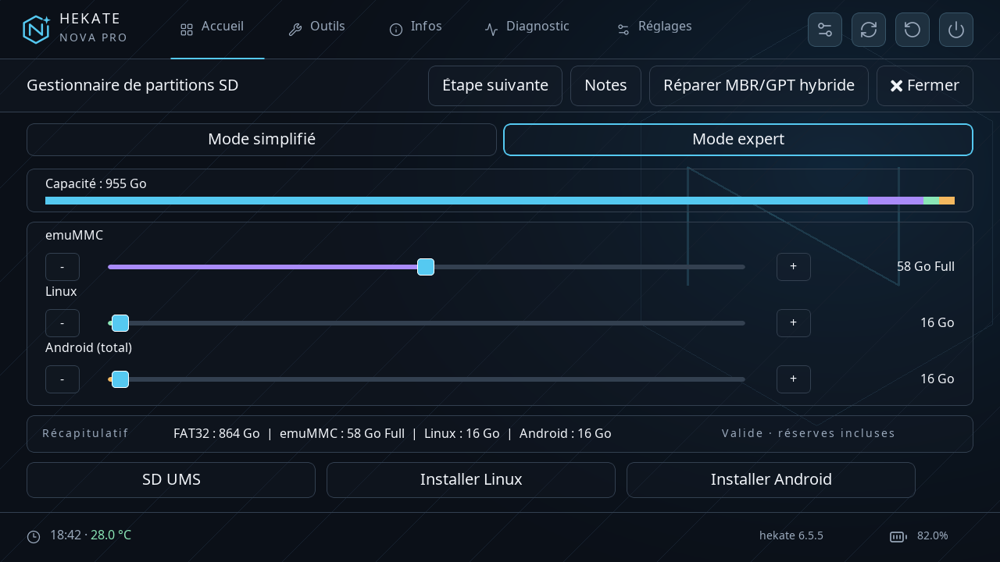

# Hekate Nova Pro — notice d’utilisation

Guide pour la **bêta v33.1**, sur base Hekate 6.5.5 / Nyx 1.9.5. Mise à jour : 15 novembre 2026.

[Paquet d’installation v33.1](https://github.com/Retrogendude/Hekate-nova-pro/releases/tag/v33.1) · [Historique](../CHANGELOG.md) · [Notice technique de la v33.1](releases/v33.1.md)

Nova s’utilise sur une console disposant déjà d’une méthode de démarrage compatible avec Hekate. La méthode de lancement dépend du modèle et de l’installation existante.

## Installation et premier démarrage

1. Dans les fichiers de la [release v32](https://github.com/Retrogendude/Hekate-nova-pro/releases/tag/v33.1), télécharger **hekate-nova-pro-v32.zip** et le décompresser sur l’ordinateur.
2. Console éteinte, conserver une copie du dossier bootloader et des réglages de la carte SD.
3. Copier les dossiers fournis **bootloader**, **fonts**, **wallpapers** et **icone** à la racine de la SD. Fusionner les dossiers existants et remplacer les fichiers livrés par la mise à jour.
4. Conserver les configurations de démarrage, les fonds et polices personnels, ainsi que les fichiers privés d’appairage. Aucun formatage n’est nécessaire pour installer cette mise à jour.
5. Utiliser **hekate_nova_pro_6.5.5_v32.bin** avec la méthode habituelle si elle nécessite un payload externe. Le fichier **bootloader/update.bin** correspondant est également fourni.
6. Remettre la SD dans la console et démarrer Nova. Le payload et le fichier bootloader/sys/nyx.bin doivent appartenir à un ensemble cohérent.

Au premier lancement, le réglage de date et d’heure d’origine est accompagné du choix de langue. Le fond Carbon, les couleurs Nova et les fenêtres à 75 % de transparence sont les valeurs par défaut d’une nouvelle installation. Les préférences déjà enregistrées restent prioritaires lors d’une mise à jour.

### Organisation de la carte SD

```text
Racine de la carte SD/
├── bootloader/
│   ├── sys/
│   └── update.bin
├── fonts/
│   ├── Lecture.nyxf
│   ├── Lecture-renforcee.nyxf
│   ├── Lecture-fixe.nyxf
│   └── MaPolice.nyxf          # facultatif
├── wallpapers/
│   ├── Nova-Carbon.bmp
│   └── MonFond.bmp            # facultatif
└── icone/
    └── diagnostic.png        # exemple facultatif
```

Les fichiers MaPolice.nyxf, MonFond.bmp et diagnostic.png ci-dessus sont des exemples à ajouter soi-même.

## Se repérer dans les menus

| Menu | Utilisation |
|---|---|
| Accueil | Configurations de démarrage, payloads, emuMMC et accès aux diagnostics. |
| Outils | Stockage, sauvegarde/restauration, accès USB et partitionnement. |
| Infos | Informations matérielles et système. |
| Diagnostic | Catégories de contrôles, tests individuels ou complets, résultats et export. |
| Réglages | Langue, lecture, apparence et options système. |

Dans les grilles **Outils, Infos et Diagnostic**, un premier appui sélectionne la tuile et affiche son détail ; un second appui sur la même tuile l’ouvre. L’icône de réglages rapides en haut à droite donne accès aux réglages Nyx.

Pour démarrer un système, ouvrir **Démarrer** et choisir une configuration déjà présente sur la SD. Les entrées affichées dépendent des fichiers de démarrage de l’installation existante.

Après une personnalisation, utiliser **Enregistrer et recharger** pour appliquer et conserver les choix. Les changements propres au logo de démarrage sont visibles au prochain démarrage de Hekate.

## Ajouter et choisir un fond d’écran

1. Copier les images dans le dossier **wallpapers** à la racine de la SD.
2. Utiliser des **BMP non compressés, en 24 ou 32 bits**, d’au plus **1920 × 1080 pixels**.
3. Choisir un nom simple, par exemple **MonFond.bmp**, sans accents ni sous-dossier.
4. Dans **Réglages Nyx → Thèmes et couleurs → Fond et transparence**, sélectionner le fond souhaité.
5. Ajuster l’opacité, puis choisir **Enregistrer et recharger**.

Le fond **Nova-Carbon.bmp** est inclus. Les images sont recadrées et mises à l’échelle au chargement. Le sélecteur présente jusqu’à 32 fonds.

Les fenêtres et les icônes disposent de réglages d’opacité distincts :

- **0 % d’opacité** : fond transparent.
- **100 % d’opacité** : fond opaque.
- **25 % d’opacité** correspond à **75 % de transparence**.

Le texte et les symboles restent visibles au-dessus des fonds. Les animations de fond ne font pas partie de la v32 ; le reflet de sélection reste désactivable dans les réglages.

### Convertir une image PNG ou JPG

Sur ordinateur Windows, conserver ensemble les fichiers du dossier **outils-fonds** fourni dans l’archive, puis glisser une image PNG ou JPG sur **convertir-fond.cmd**. Copier le BMP obtenu dans le dossier wallpapers de la SD.

Ce convertisseur nécessite Python 3 et Pillow. Leur préparation est décrite plus bas.

## Choisir et ajouter une police

Trois polices compatibles sont fournies dans **fonts**, à la racine du paquet :

| Fichier | Présentation |
|---|---|
| Lecture.nyxf | Police régulière, dérivée de Noto Sans. |
| Lecture-renforcee.nyxf | Trait renforcé pour le contraste. |
| Lecture-fixe.nyxf | Caractères à largeur fixe. |

Dans **Réglages → Apparence et lecture**, choisir la police et la taille du texte, puis **Enregistrer et recharger**. Les tailles principales proposées vont de 20 à 36 pixels ; les petits libellés utilisent une taille adaptée. Les rapports techniques conservent une police à chasse fixe pour aligner leurs colonnes.

### Ajouter sa propre police

1. Sur l’ordinateur, extraire le dossier **outils-polices** complet. Conserver ensemble convertir-police.cmd et ses sous-dossiers **tools** et **source**.
2. Glisser le fichier **TTF ou OTF** sur **outils-polices/convertir-police.cmd**.
3. Récupérer le fichier **.nyxf** créé à côté de la police d’origine.
4. Copier ce fichier dans **fonts**, à la racine de la SD, avec un nom simple tel que **MaPolice.nyxf**.
5. Recharger Nyx pour actualiser la liste, sélectionner la police et enregistrer.

La console charge les fichiers **NYXF** ; un fichier TTF ou OTF doit donc être converti avant son ajout. Le convertisseur produit les tailles prévues et utilise Noto Sans comme secours pour les caractères manquants. Sa couverture correspond aux alphabets latins, au cyrillique et à la ponctuation nécessaires aux sept langues proposées ; cela ne constitue pas une police universelle pour tous les systèmes d’écriture.

Le sélecteur accepte jusqu’à 16 fichiers supplémentaires. Employer un nom de moins de 64 caractères, composé de lettres sans accents, chiffres, espaces, tirets, points ou traits de soulignement. Un fichier absent ou invalide entraîne l’utilisation de la police intégrée.

Utiliser des polices dont la licence permet la conversion et, en cas de partage, la redistribution. Les variantes Lecture fournies sont accompagnées de la licence SIL OFL de leur source.

### Préparer les convertisseurs sous Windows

Les deux convertisseurs, fonds d’écran et polices, nécessitent **Python 3** et **Pillow** sur l’ordinateur. Une fois Python disponible, installer Pillow dans un terminal avec :

```text
python -m pip install Pillow
```

Puis utiliser les programmes .cmd fournis par glisser-déposer. Aucun convertisseur ni Python n’est nécessaire sur la console. Les polices et le fond Carbon déjà fournis sont prêts à l’emploi.

## Personnaliser les icônes et la tuile Démarrer

Pour remplacer les cinq petits pictogrammes de l’accueil, copier des PNG avec transparence dans **icone**, avec ces noms :

| Nom du fichier | Tuile |
|---|---|
| launch.png | Démarrer |
| configs.png | Configurations |
| payloads.png | Payloads |
| emummc.png | emuMMC |
| diagnostic.png | Diagnostic |

Privilégier une image carrée avec des marges transparentes. Les proportions sont conservées. Les images doivent rester dans les limites de **1920 × 1080 pixels** et **8 Mio**. Recharger Nyx après leur modification ; une icône absente ou invalide laisse le pictogramme Nova affiché.

Pour l’image de la grande tuile Démarrer / Launch, copier une image distincte dans icone, puis la choisir dans **Réglages Nyx → Thèmes et couleurs → Tuile Launch**. **Aucune image** restaure le fond normal de cette tuile. Le fond d’écran général reste choisi séparément depuis wallpapers et utilise les BMP.

## Diagnostics et test mémoire

Dans Diagnostic, sélectionner une catégorie puis lancer le contrôle souhaité ou le test complet. Les résultats et le bilan par composant sont consultables et exportables depuis les écrans de résultats. Les rapports sont enregistrés dans **bootloader/diagnostics**.

Les contrôles interactifs permettent notamment de vérifier boutons/sticks, couverture du tactile et mires d’écran. Le test mémoire s’exécute dans un programme séparé avec retour à Hekate ; choisir son mode puis exporter les résultats au retour. Un matériel instable peut empêcher le retour normal.

Un verdict PASS ne concerne que les contrôles réellement exécutés. Une identification correcte d’une puce ne certifie pas toutes ses fonctions. Le bilan distingue résultats mesurés, contrôles non effectués et observations manuelles.

## Partitionnement expert

Le mode expert propose trois rangées : emuMMC, Linux et Android. Les tailles sont placées à droite des barres ; les boutons **−/+** affinent le réglage, avec répétition si l’appui est maintenu.

- Les repères **29 Go Full** et **58 Go Full** conservent les allocations complètes Hekate selon le modèle.
- Les tailles affichées sont entières ; les réserves et alignements restent comptés dans les calculs.
- Android affiche son allocation totale, système inclus.
- Le récapitulatif inférieur regroupe les allocations et leur état sur une ligne.

Le partitionnement modifie le support après les confirmations prévues par Hekate. Conserver une sauvegarde des données avant cette opération. Installer ou mettre à jour Nova ne lance aucun partitionnement.



## TV et Joy-Con sans fil

### Sortie TV

Dans les réglages Nyx, ouvrir l’onglet **TV / Dock**, puis les réglages **USB-C TV / Dock**. Choisir l’affichage sur le téléviseur seul ou sur le téléviseur et la console, ainsi que l’option de détection automatique du dock.

Le branchement de référence est une console compatible directement insérée dans un dock officiel alimenté, avec HDMI relié au téléviseur. La **Switch Lite ne dispose pas de sortie TV**. La validation matérielle dépend du modèle et du branchement ; les notices des versions TV décrivent les essais conservés.

### Première utilisation Bluetooth

1. Utiliser des Joy-Con déjà appairés à cette console, puis les fixer sur leurs rails.
2. Ouvrir **Joy-Con sans fil** depuis les réglages TV / Dock et choisir **Lire les appairages**.
3. Après un import valide, Bluetooth arrêté, choisir **Sauvegarder les appairages**.
4. Détacher les Joy-Con, choisir **Activer Bluetooth** et appuyer sur un bouton pour les réveiller. Laisser les sticks au repos un instant avant de naviguer.

Aux démarrages suivants, si les deux rails sont vides et qu’un fichier d’appairage valide a été sauvegardé, Nova peut le recharger et démarrer le service automatiquement, sans ouvrir sa fenêtre. La présence d’un Joy-Con sur un rail empêche cet automatisme. Un arrêt manuel reste respecté pour ce démarrage. Certains outils et diagnostics réservent les périphériques et arrêtent le service : le relancer manuellement ensuite si nécessaire.

La v32 redemande les rapports d’un Joy-Con devenu silencieux et peut reconnecter ce seul pair. **La portée de 2–3 mètres n’est pas encore garantie et reste à valider sur console.**

### Signaler un problème

Après l’essai, choisir **Arrêter Bluetooth** et conserver immédiatement **bootloader/bluetooth/last-session.txt**, avant de relancer ou de relire les appairages. Indiquer la version, le modèle, la distance et la présence ou non d’un dock.

Transmettre uniquement le rapport texte. **Ne pas publier joycon-pairing.bin, joycon-pairing.bak, prod.keys, title.keys ou des dumps personnels.** Les sauvegardes d’appairage contiennent des clés privées ; elles ne sont pas incluses dans les archives du projet.

## Sources et limites

Cette notice décrit la v32. Les notices historiques et résultats de vérification restent dans [les documents de chaque version](releases/v33.1.md) et [les releases](https://github.com/Retrogendude/Hekate-nova-pro/releases). Les contrôles sur PC et les périphériques simulés ne remplacent pas une validation sur la console réelle.

## Nouveautés v33.1 : langues, icônes et démarrage

Huit langues : anglais, français, espagnol, italien, russe, allemand, portugais et chinois simplifié. Le chinois utilise sa ressource obligatoire bootloader/sys/Nova-Chinese-Simplified.nyxf ; la police personnelle est conservée et le choix redevient disponible en quittant cette langue. La taille reste réglable. Les longs rapports chinois restent à relire.

Le choix de police Par défaut emploie Lecture.nyxf pour les langues latines et la famille intégrée pour le russe. Le choix Hekate d’origine utilise la police intégrée sans installation supplémentaire. Placer les polices NYXF personnelles dans /fonts ; un fichier TTF/OTF ne peut pas être chargé directement.

À la première installation sans nyx.ini : français, Carbon Cyan, taille 30, opacité fenêtres/icônes à 75 %, couleurs Nova fournies. Le réglage d’horloge d’origine est conservé. Les fichiers de configuration existants ont priorité et ne sont pas remplacés par le pack.

La tuile Démarrer utilise deux images : /icone/launch.png pour la petite icône en haut à gauche et le fichier choisi par launch_image, par défaut /icone/Launcher.png, pour le grand fond remplaçable dans Nova. Les autres icônes et les fonds BMP se trouvent dans /icone et /wallpapers. Conserver les caractères de casse des noms fournis et une copie des images personnelles avant remplacement.

Réglages > Options de démarrage regroupe Auto Boot, délai, Auto NoGC et Auto HOS Power Off. Le sélecteur Auto Boot présente les entrées existantes par pages. Le lien Luminosité rejoint le curseur déjà présent. Enregistrer après modification.

## Consoles modifiées RAM 8 Go

Choisir le pack standard pour les consoles normales. Le pack 8GB est expérimental et exclusivement destiné aux consoles physiquement modifiées ; ne pas mélanger son payload et le dossier bootloader d’un autre pack. Atmosphère 1.11.0 minimum et configuration mémoire adaptée sont nécessaires. Lire [le guide RAM 8 Go](RAM-8GO-V33.1.md) avant utilisation : profils Erista/Mariko, réglage memmode, limites et état des essais.

Le diagnostic préserve le mode 8 Go au lancement et au retour. Il accède aux adresses hautes et rapporte séparément capacité, zone testable et zone vérifiée. Sur 8192 Mio, 8176 Mio sont testables ; 16 Mio restent protégés. Les contrôles PC ne certifient pas les puces de remplacement et ne remplacent pas une validation sur chaque modèle.


## v33.3 — Halo à deux couleurs

Dans Interface > Thèmes et couleurs > Couleurs, Halo remplace le choix Fond. Choisir Couleur 1, régler la palette, puis Couleur 2. L’aperçu affiche le dégradé immédiatement ; les deux choix sont conservés entre onglets. Enregistrer et recharger applique et conserve les couleurs. Fermer sans sauvegarder abandonne les modifications. Les anciennes configurations gardent le bleu/violet par défaut et leur fond existant. Les corrections des contours de la v33.2 sont incluses.
